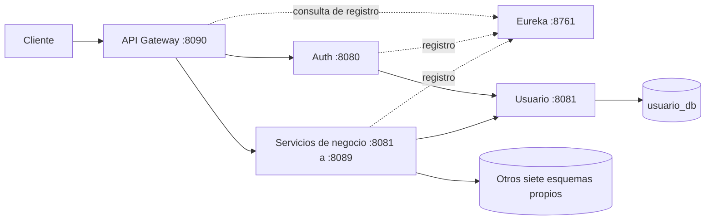

# Sistema de Gestión de Estacionamientos

**Backend basado en microservicios con Java y Spring Boot**

Proyecto académico desarrollado colaborativamente para la asignatura FullStack 1 de Ingeniería en Informática, Duoc UC.

## Descripción

El sistema organiza la operación de un estacionamiento: administración de usuarios, vehículos y plazas, registro de ingresos, reservas de visitas y liberaciones. Centraliza los movimientos para consultar reportes y permite ejecutar un cierre operativo con un resumen histórico.

El backend separa estas responsabilidades en diez servicios de negocio, comunicados mediante APIs REST. La rama `main` incorpora API Gateway y Eureka, además de una configuración Docker para desarrollo local. Esta documentación describe la implementación publicada en `78ef4d1`, no una certificación de disponibilidad ni de preparación para producción.

## Tecnologías utilizadas

| Categoría | Tecnologías presentes en `main` |
|---|---|
| Lenguaje y framework | Java 21, Spring Boot 4.0.6 |
| Desarrollo backend | Spring WebMVC, Jakarta Validation, Lombok, Actuator |
| Persistencia | MySQL 8.4 en Compose, Spring Data JPA, Flyway en ocho servicios |
| Seguridad | Spring Security, JWT con Auth0 `java-jwt` 4.4.0, BCrypt |
| Arquitectura y comunicación | REST/HTTP, RestTemplate, WebClient en clientes de Plaza, Eureka y Spring Cloud Gateway Server WebMVC |
| Infraestructura | Docker, Docker Compose; una instancia MySQL con esquemas separados |
| Testing | JUnit Jupiter, Mockito, Spring Boot Test, H2 en determinados perfiles de prueba |
| Herramientas de desarrollo | Maven, Maven Wrapper en servicios de negocio, Git; OpenAPI con springdoc 2.8.9 configurado |

Las dependencias y perfiles no son idénticos en todos los módulos. OpenAPI está configurado, pero su respuesta HTTP y compatibilidad efectiva requieren validación. [Inventario técnico](docs/arquitectura.md).

## Funcionalidades principales

- **Autenticación:** login, comparación BCrypt y emisión de JWT; autorización por autoridades en parte de los servicios.
- **Usuarios:** creación, consulta, actualización y eliminación; consulta de roles.
- **Vehículos:** administración por usuario, consulta por patente y catálogo de tipos.
- **Plazas:** consulta y actualización de estado; ocupación por código.
- **Ingresos:** validación de usuario, vehículo y plaza, registro de acceso e intento de registrar su movimiento.
- **Reservas:** creación, consulta y eliminación de reservas de visitas, con cambio de plaza a reservada al crear.
- **Liberaciones:** cambio de una plaza ocupada o reservada a disponible y registro de la liberación.
- **Movimientos:** registro y consultas por tipo, usuario, patente, plaza, origen y fecha.
- **Reportes:** resumen global, resumen por fecha y reporte completo desde Plaza y Movimiento.
- **Cierres:** liberación de plazas ocupadas, eliminación de reservas y liberación de sus plazas; almacenamiento de resumen histórico.

Son capacidades identificadas en código. La eliminación individual de una reserva **no libera su plaza**. La bitácora admite fallos parciales; no se garantiza que toda operación produzca un movimiento.

## Arquitectura

El Gateway configura rutas `lb://` hacia los servicios registrados en Eureka. Los clientes HTTP internos usan URLs explícitas, no descubrimiento dinámico. Auth consulta Usuario y emite JWT; los servicios de negocio validan el token localmente según su configuración de seguridad. Auth y Reporte no tienen persistencia de negocio; los otros ocho servicios acceden a su propio esquema MySQL.



El bloque de servicios agrupa Usuario, Vehículo, Plaza, Reserva, Acceso, Movimiento, Liberación, Cierre y Reporte. Las flechas de persistencia no aplican a Reporte; el [diagrama detallado](docs/arquitectura.md) desglosa cada relación. Los puertos directos también están publicados por Compose: Gateway no es la única vía de acceso.

La configuración Docker ejecuta los doce procesos Java en **un solo contenedor**, junto a otro contenedor MySQL. No es un contenedor por microservicio ni un despliegue productivo validado.

## Microservicios

Puertos verificados en los perfiles `dev` y `docker`; Gateway y Eureka, en sus YAML.

| Servicio | Responsabilidad | Puerto |
|---|---|---|
| [Auth](auth_service/) | Login y emisión de JWT | 8080 |
| [Usuario](usuario_service/) | Usuarios y roles | 8081 |
| [Vehículo](vehiculo_service/) | Vehículos y tipos | 8082 |
| [Plaza](plaza_service/) | Plazas y estados | 8083 |
| [Reserva](reserva_service/) | Reservas de visitas | 8084 |
| [Acceso](acceso_service/) | Registro de ingresos | 8085 |
| [Movimiento](movimiento_service/) | Bitácora central | 8086 |
| [Liberación](liberacion_service/) | Liberación de plazas | 8087 |
| [Cierre](cierre_service/) | Cierre operativo e histórico | 8088 |
| [Reporte](reporte_service/) | Reportes agregados | 8089 |
| [API Gateway](api_gateway/) | Enrutamiento HTTP | 8090 |
| [Eureka](eureka_server/) | Registro de servicios | 8761 |

## Requisitos previos

- **Con Docker:** Git, Docker Engine o Desktop activo y Docker Compose con `docker compose`. Las imágenes de construcción incluyen Maven 3.9 y Java 21; MySQL 8.4 se obtiene desde Compose.
- **Ejecución individual:** JDK 21, Maven (3.8.7 comprobado para las pruebas; Docker usa 3.9) o Wrapper donde exista, y MySQL con los esquemas y permisos preparados. Gateway y Eureka requieren Maven instalado porque no incluyen Wrapper.
- **Opcionales:** IDE, cliente MySQL y `curl` para comprobaciones HTTP. Se necesita acceso a repositorios Maven e imágenes Docker en la primera ejecución.

## Instalación y ejecución

```bash
git clone https://github.com/FernandezfIT/Estacionamientos_Springboot_FullsStack1_2026.git
cd Estacionamientos_Springboot_FullsStack1_2026
cp .env.ejemplo .env
```

**Antes de iniciar:** completar `.env` con `JWT_SECRET` y `JWT_EXPIRATION`, y revisar la coherencia entre las credenciales MySQL y el SQL de inicialización. El ejemplo actual no incluye todas las variables y el SQL no las interpola. No basta con copiar el archivo. No publicar `.env` ni reutilizar valores de desarrollo.

Una vez resuelta esa preparación local:

```bash
docker compose config --quiet
docker compose up --build -d
docker compose ps
docker compose logs -f microservicios
```

Revisar Eureka en `http://localhost:8761/` y comprobar respuestas de los servicios, no solo el estado del contenedor. **El arranque Docker completo no se ejecutó en esta revisión:** el daemon no estaba disponible. Se verificaron estáticamente Compose, Dockerfile, perfiles y entrypoint. Las instrucciones individuales y los bloqueos de inicialización están en [instalación](docs/instalacion.md).

## Pruebas automatizadas

Hay pruebas unitarias de servicios con JUnit Jupiter y Mockito, y una prueba de carga de contexto por servicio de negocio. Desde la raíz, por ejemplo:

```bash
# Solo pruebas unitarias de Auth; comando ejecutado en esta revisión
mvn -f auth_service/pom.xml '-Dtest=*ServiceTest' test
# Suite del módulo; puede requerir infraestructura según su perfil
(cd auth_service && ./mvnw test)
```

La ejecución de las diez suites con Maven produjo **84 pruebas: 80 satisfactorias, 4 errores de contexto por MySQL no disponible y 0 omitidas**. Las 74 pruebas unitarias pasaron también en una ejecución aislada. Gateway y Eureka compilaron con `mvn test`, sin pruebas implementadas. No se midió cobertura ni se ejecutó una prueba extremo a extremo. [Resultados y requisitos](docs/pruebas.md).

## Documentación API

Los diez servicios de negocio configuran Swagger UI en `http://localhost:<puerto>/doc/swagger-ui.html` y OpenAPI en `http://localhost:<puerto>/v3/api-docs`. Por ejemplo, Auth usa el puerto 8080 y Usuario el 8081. Son direcciones derivadas de configuración, **pendientes de comprobar por HTTP**; no hay agregación Swagger configurada en Gateway.

[Catálogo de endpoints y restricciones de acceso](docs/api-endpoints.md).

## Desarrollo y contribuciones

El proyecto es trabajo de un equipo académico. El historial respalda aportes de Felipe Fernández (`FernandezfIT`) en Auth, Usuario, Vehículo, Acceso, Movimiento y Cierre, además de pruebas, documentación y entorno MySQL inicial. No se atribuye autoría exclusiva de estos módulos.

Los commits de `NovoaCl` documentan aportes en Plaza, Reserva, Liberación y Reporte, sus pruebas, Gateway/Eureka y la contenedorización final. [Evidencias y límites de atribución](docs/contribuciones.md).

## Estado del proyecto

- **Implementado en `main`:** diez servicios de negocio, seguridad JWT, persistencia separada, pruebas, OpenAPI configurado, Gateway/Eureka y archivos para Docker.
- **Comprobado aquí:** revisión estática, compilación con las pruebas indicadas y sus resultados. No se certifica el flujo distribuido completo.
- **Ramas:** `testing/eureka-gateway` ya está integrada. La rama antigua `usuario-service/Logs-Swagger` tiene un commit no alcanzable desde `main`; no se considera una capacidad publicada adicional.
- **Limitaciones:** reservas sin programación futura; cierre elimina todas las reservas existentes; fallos parciales entre servicios sin transacción distribuida; configuración local con valores sensibles versionados y endpoints internos de Usuario públicos. No exponer el sistema sin revisar su seguridad.
- **Mejoras futuras:** cambio de plaza, reservas programadas y su conservación al cerrar, reportes por rango, paginación, trazabilidad y colección de pruebas HTTP. No forman parte de la implementación actual.

## Documentación adicional

### Referencia vigente

- [Arquitectura e inventario técnico](docs/arquitectura.md)
- [Instalación y ejecución](docs/instalacion.md)
- [Endpoints](docs/api-endpoints.md)
- [Pruebas](docs/pruebas.md)
- [Contribuciones y publicación](docs/contribuciones.md)
- [Auditoría, evidencias y pendientes](docs/auditoria-documental.md)

### Documentación histórica conservada

- [Instructivo inicial de MySQL local](docs/INSTRUCTIVO_MYSQL_LOCAL.md)
- [Manual de estandarización](docs/MANUAL_ESTANDARIZACION_MICROSERVICIOS.md)
- [Patrón de integración con Movimiento](docs/patron_integracion_movimiento_reserva_liberacion.md)
- [Resumen temprano de avance](docs/resumen_avance_microservicios_estacionamientos.md)

Estos documentos registran etapas y decisiones del equipo; las guías vigentes explican sus diferencias con la versión publicada.
