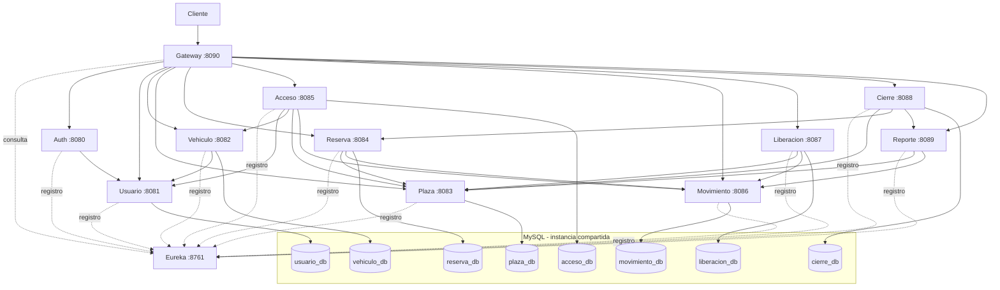

# Arquitectura e inventario técnico

Referencia: `origin/main` en `78ef4d1`. Este inventario procede de código y configuración; no sustituye pruebas de integración.

## Separación de responsabilidades

Cada módulo es un proyecto Maven independiente, sin POM agregador en la raíz. Los servicios de negocio separan controladores, DTO, lógica de servicio, clientes HTTP y, cuando corresponde, entidades y repositorios. Las operaciones entre módulos utilizan HTTP; no se identificaron consultas cruzadas a tablas de otro esquema en los clientes revisados.

Hay ocho esquemas de negocio en una instancia MySQL: `usuario_db`, `vehiculo_db`, `plaza_db`, `reserva_db`, `acceso_db`, `movimiento_db`, `liberacion_db` y `cierre_db`. Esto es separación lógica, no ocho servidores MySQL. Auth consulta Usuario; Reporte agrega datos de Plaza y Movimiento. Ninguno de esos dos servicios persiste entidades de negocio, aunque el script inicial cree también `auth_db` y `reporte_db`.

## Relaciones implementadas

Gateway configura rutas para los diez servicios; consulta el registro de Eureka mediante LoadBalancer. Las líneas discontinuas representan registro/consulta de descubrimiento, no tráfico de negocio. Cada conexión a MySQL representa acceso únicamente al esquema indicado.

Compose también expone los puertos individuales; un cliente puede omitir Gateway. Los clientes internos usan URLs explícitas `app.services.*.base-url` a `localhost`, incluso en Docker, porque las doce JVM comparten contenedor. No usan `lb://` ni clientes declarativos Feign.

## Inventario por módulo

Todos los POM declaran Java 21 y Spring Boot 4.0.6. El BOM Spring Cloud es 2025.1.1. Puertos derivados de `application-dev.properties` y `application-docker.properties`, o YAML para infraestructura.

| Módulo | Puerto | Persistencia | Dependencias HTTP salientes | Perfiles presentes |
|---|---|---|---|---|
| `auth_service` | 8080 | Sin BD de negocio; autoconfiguración excluida | Usuario, RestTemplate | dev, docker, test |
| `usuario_service` | 8081 | usuario_db; JPA/Flyway | Ninguna identificada | dev, docker, test, prod |
| `vehiculo_service` | 8082 | vehiculo_db; JPA/Flyway | Usuario, RestTemplate | dev, docker, test |
| `plaza_service` | 8083 | plaza_db; JPA/Flyway | Ninguna identificada | dev, docker, test, prod |
| `reserva_service` | 8084 | reserva_db; JPA/Flyway | Plaza con WebClient; Movimiento con RestTemplate | dev, docker, test, prod |
| `acceso_service` | 8085 | acceso_db; JPA/Flyway | Usuario, Vehículo, Plaza, Movimiento; RestTemplate | dev, docker, test |
| `movimiento_service` | 8086 | movimiento_db; JPA/Flyway | Ninguna identificada | dev, docker, test |
| `liberacion_service` | 8087 | liberacion_db; JPA/Flyway | Plaza con WebClient; Movimiento con RestTemplate | dev, docker, test, prod |
| `cierre_service` | 8088 | cierre_db; JPA/Flyway | Plaza, Reserva, Reporte; RestTemplate | dev, docker, test |
| `reporte_service` | 8089 | Sin BD de negocio | Plaza, Movimiento; RestTemplate | dev, docker, test, prod |
| `api_gateway` | 8090 | Sin BD | Servicios vía `lb://` y Eureka | base, docker |
| `eureka_server` | 8761 | Sin BD | Registro Eureka, sin registrarse a sí mismo | base, docker |

### Dependencias y diferencias

- Los diez servicios de negocio incluyen WebMVC, Security, Validation, Lombok, `java-jwt`, springdoc y Eureka Client/Actuator.
- Los ocho servicios persistentes incluyen JPA, Flyway y conector MySQL; Auth también declara dependencias de persistencia, pero las desactiva por configuración. Reporte no declara JPA/MySQL.
- Reserva y Liberación incluyen WebFlux para sus clientes WebClient; ello no convierte al sistema completo en reactivo: los clientes llaman a `.block()`.
- Auth y Vehículo declaran además el starter RestClient, pero sus clientes revisados utilizan RestTemplate. Una dependencia declarada no implica su uso en todas las llamadas.
- Seis módulos (Auth, Usuario, Vehículo, Acceso, Movimiento y Cierre) incorporan configuración Logback y `logstash-logback-encoder`. No hay plataforma de observabilidad externa desplegada por Compose.
- Gateway usa `spring-cloud-starter-gateway-server-webmvc`, Eureka Client, LoadBalancer y Actuator. Eureka Server usa el starter servidor Netflix y Actuator.
- Los POM incluyen starters de prueba especializados; JUnit Jupiter y Mockito se observan en las clases de test. H2 no está declarado en Auth ni Reporte; sí en los ocho servicios persistentes.
- `dev` es el perfil activo por defecto de los servicios de negocio. `docker` utiliza `mysql-local:3306`; `dev`, MySQL en localhost:3306. Los perfiles `test` no son uniformes y hay configuración adicional en `src/test/resources` de Plaza, Reserva y Liberación.
- Los perfiles `prod` de Usuario, Plaza, Reserva y Liberación solo declaran el nombre de aplicación. Reporte tiene URLs diferentes para ese perfil. Su existencia no acredita un ambiente productivo preparado.

## Seguridad

Auth obtiene datos de autenticación desde Usuario, compara BCrypt y firma JWT HMAC. Usuario aplica BCrypt al crear o actualizar contraseñas. Los filtros JWT de los servicios de negocio validan tokens localmente; varias llamadas reenvían `Authorization: Bearer ...`.

| Servicio | Política observada para su API |
|---|---|
| Auth | Login público; no requiere una sesión previa |
| Usuario y roles | Administración con autoridades `Jefe_Seguridad` o `Jefe_SSDD`; consultas de autenticación/existencia/RUT permitidas sin token |
| Vehículo | Consultas para jefaturas y `Guardia`; escritura para jefaturas |
| Acceso y Movimiento | Registro y consultas específicas admiten `Guardia` y jefaturas; listado global restringido a jefaturas |
| Cierre | Ejecución y consulta restringidas a jefaturas |
| Plaza, Reserva, Liberación y Reporte | API autenticada; no se observa filtro por rol equivalente en SecurityConfig |

Las autorizaciones efectivas de un flujo también dependen del servicio llamado: por ejemplo, Reporte exige autenticación localmente, pero Movimiento limita el listado global a jefaturas. El rol `Funcionario` existe entre los roles del sistema, sin implicar permisos administrativos.

Swagger tiene rutas permitidas en SecurityConfig. Actuator se expone por propiedades, pero la seguridad de varios módulos termina en `denyAll`: **no se usa su URL como prueba universal de salud**.

**Limitación de seguridad:** Usuario publica consultas internas y un DTO de autenticación con hash de contraseña. El Gateway también enruta `/api/v1/usuarios/**`, sin una barrera adicional configurada para esas consultas. El sistema contiene valores sensibles de desarrollo versionados. No desplegar públicamente sin una revisión específica; esta entrega no altera seguridad ni credenciales.

## Flujos y límites transaccionales

1. **Login:** Auth consulta Usuario por email, compara BCrypt y genera token.
2. **Acceso:** valida usuario por RUT, vehículo y pertenencia, ocupa plaza, persiste acceso e intenta registrar movimiento `ACCESO`.
3. **Reserva:** comprueba plaza disponible, la marca reservada, guarda una reserva de visita e intenta registrar movimiento `RESERVA`. No valida el visitante contra Usuario/Vehículo. El borrado individual no libera plaza.
4. **Liberación:** acepta plaza ocupada o reservada, la cambia a disponible, guarda liberación e intenta registrar `SALIDA`.
5. **Reporte:** consulta plazas y movimientos para resúmenes globales, por fecha o completos. No ejecuta las acciones operativas de cierre.
6. **Cierre:** libera plazas ocupadas, elimina todas las reservas obtenidas, libera sus plazas, consulta resumen del día y guarda un snapshot histórico. No conserva reservas futuras ni implementa programación automática del cierre.

Las transacciones JPA son locales. Si una llamada remota modificó Plaza y luego falla una escritura local, el rollback local no revierte el cambio remoto. Acceso, Reserva y Liberación capturan errores al registrar movimientos, por lo que la bitácora puede quedar incompleta. No se identificó coordinación distribuida, outbox ni compensación integral en estos flujos.

## Docker y descubrimiento

[Compose](../docker-compose.yml) contiene `mysql-local` y `microservicios`, una red bridge y el volumen `mysql_data`. El [Dockerfile](../docker/microservices/Dockerfile) construye doce JAR con Maven/Java 21 y omite tests con `-DskipTests`. El [entrypoint](../docker/microservices/entrypoint.sh) arranca Eureka, servicios y Gateway usando pausas, sin supervisión individual ni verificación de disponibilidad entre etapas.

El estado del contenedor no demuestra que las doce aplicaciones estén vivas. La comprobación operativa de registro, rutas y negocio queda pendiente. El perfil base del Gateway solo incluye `/api/v1/tipos-vehiculo/**` (singular); el controlador utiliza `/api/v1/tipos-vehiculos` y el perfil Docker sí incorpora esa ruta plural.

## Ramas y siguientes iteraciones

`testing/eureka-gateway` está integrada en `main` y carece de commits exclusivos. `main` añade después la contenedorización. Las demás ramas de funcionalidades revisadas son ancestros de `main`, excepto el commit antiguo `f88aab3` de `usuario-service/Logs-Swagger`; se documenta como divergencia histórica, no como una nueva arquitectura pendiente.

Mejoras propuestas, no implementadas: servicio de cambio de plaza, reservas programadas, conservación selectiva de reservas en cierre, reportes por rangos de fecha, paginación/ordenamiento, identificadores de correlación y colección Postman. Swagger ya está configurado: la tarea pendiente es verificarlo, no presentarlo como inexistente.

Véanse [auditoría](auditoria-documental.md), [instalación](instalacion.md) y [pruebas](pruebas.md).
